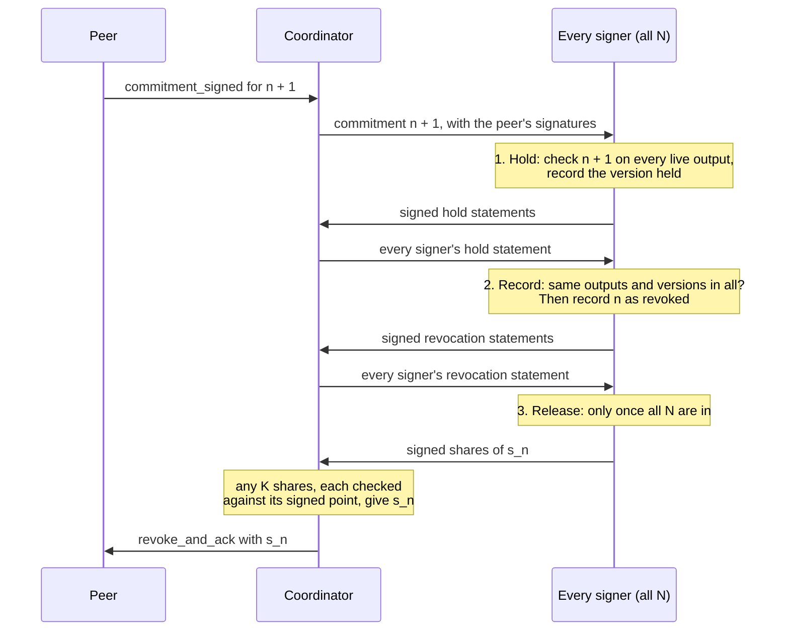

# A K-of-N signer group under `option_independent_secrets`

A design note: one way for a Lightning node whose keys are held by several
signers to meet the multi-signer requirements of [BOLT 3, "Independent
Per-commitment Secrets"](https://github.com/lightning-blake2b/bolts/pull/17).

BOLT 3 states what such a node must ensure. This note describes how a group
of signers can ensure it. Everything here happens inside the node, between
its signers, and nothing in it is visible to the channel peer, which sees an
ordinary channel with `option_independent_secrets`. So this note is not part
of the spec, and another design that meets the same requirements is as good.

Status: a draft, for discussion. The parts most in need of review are listed
under [Open questions](#13-open-questions).

## In brief

- **The problem.** With a shachain, every signer has to hold the seed, so
  any one of them can hand the peer the secret of the node's current
  commitment. `option_independent_secrets` lets the signers make each
  secret jointly instead.
- **Secrets and points.** Each secret is a sum of PRF outputs under keys
  shared within groups of signers, arranged so that any K − 1 signers miss
  one key, and any K can reveal the secret (section 3). Each signer works
  out every per-commitment point itself from 2K − 1 signed shares, so no
  K − 1 can choose or change it.
- **Revoking needs all N.** No share of a secret is released until every
  signer has recorded the revocation, and no signer records it until every
  signer has said it holds the same next commitment (section 5). A signer
  never helps sign a commitment it has revoked, nor revokes one it has
  helped sign.
- **Closing needs K.** Each signer goes by its own records, so up to K − 1
  colluding signers, with the coordinator and the peer, can neither block a
  close nor get a revoked commitment broadcast, given N ≥ 2K − 1 (N ≥ 2K is
  safer, section 7).
- **What it relies on.** Signers that check everything they sign, records
  kept where a restore can't roll them back (section 8), and a signing
  scheme any K can complete (section 10). That scheme, for MuSig2 and for
  threshold ECDSA, is the main part left open.
- **What it costs.** C(N, K − 1) keys, so small groups only; every signer
  online for every update; no zero-conf splices (section 11).

## Contents

1. [The setting](#1-the-setting)
2. [Keys](#2-keys)
3. [Per-commitment secrets and points](#3-per-commitment-secrets-and-points)
4. [What each signer records](#4-what-each-signer-records)
5. [Revoking a commitment](#5-revoking-a-commitment)
6. [Signing a commitment to broadcast](#6-signing-a-commitment-to-broadcast)
7. [Restored signers](#7-restored-signers)
8. [Records a restore can't roll back](#8-records-a-restore-cant-roll-back)
9. [Splices](#9-splices)
10. [Nonces](#10-nonces)
11. [What it costs](#11-what-it-costs)
12. [How it meets the BOLT 2 and BOLT 3 requirements](#12-how-it-meets-the-bolt-2-and-bolt-3-requirements)
13. [Open questions](#13-open-questions)
14. [References](#14-references)

## 1. The setting

N signers each hold a share of the node's funding key, and of the secrets of
its basepoints (payment, delayed payment, HTLC and revocation), and any K of
them can sign with each. Something coordinates them and talks to the peer:
call it the coordinator. It may be one of the signers, the node's own
software, or a separate machine. It holds no key material and is not trusted:
no signer relies on anything it says that the signer can't check.

**What it protects against.** Up to K − 1 signers acting together, with the
coordinator, and with the channel peer. They must not be able to:

- get both the secret of a commitment and a signature with which the node
  can broadcast that commitment (that hands the channel to the peer);
- make the node broadcast a revoked commitment;
- while the other signers can still sign, leave the node without a
  commitment it has not revoked that it can broadcast, with its HTLC
  transactions, on every funding output that a commitment of the node can
  still spend.

That is the outcome BOLT 3 requires. BOLT 3 writes t for the number of
signers whose parts make up a secret and s for the number needed to sign;
here t = s = K.

**What it assumes.**

- Each signer checks everything it signs, as a validating signer such as
  VLS does: what each commitment pays, its HTLCs, and the funding outputs.
  It works out the commitment number of anything it checks or signs from
  the transaction itself, and the per-commitment point from the signed
  shares of section 3, not from what it is told.
- Each signer keeps its records (section 4) where a restore can't roll them
  back (section 8), and writes each record durably before any message that
  depends on it leaves.
- The signers can reach each other directly, and each can act without the
  coordinator.
- Each signer has its own view of the chain, from a node it trusts, for
  seeing funding outputs confirm, get spent, or become final.
- N ≥ 2K − 1, so that the K − 1 who might collude can't block a close.
  N ≥ 2K is safer (section 7); 2-of-4 is the natural size.

## 2. Keys

For every set A of K − 1 signers there is one key k_A, held by the N − K + 1
signers outside A. There are C(N, K − 1) such keys: 3 for 2-of-3, 4 for
2-of-4, 10 for 3-of-5, 35 for 4-of-7. So this is for small groups.

For 2-of-3, each set A is one signer, and its key is held by the other two:

| Key  | Held by          | Missing from |
|------|------------------|--------------|
| k_1  | signers 2 and 3  | signer 1     |
| k_2  | signers 1 and 3  | signer 2     |
| k_3  | signers 1 and 2  | signer 3     |

Each signer lacks one key, so it can't work out a secret
s_n = v_1 + v_2 + v_3 by itself (v_i is the term under k_i, section 3),
while any two signers between them hold all three keys.

Each key is made once per signer set by its holders alone: each holder
contributes randomness, encrypted to the other holders, and the key is a
hash of all the holders' contributions. Every two holders of a key then
compare a signed check value of it, a hash under a label of its own, which
the other signers see too; nothing is used until every signer has checked
every key it can. No signer, and not the coordinator, learns a key it
doesn't hold.

Each channel's funding key is made afresh for that channel, by all N
signers, and bound to its channel value c (section 3), so a share of it is
never used on another channel; so is each splice's new funding key
(section 9). Each signer backs up its keys k_A; each channel's c, its own
contribution to it, and its funding-key share before its hold statement
under rule 0 leaves; each splice's key share as soon as that key's
generation completes, before its first hold statement naming the new
output leaves; and whatever it needs to complete its nonces (section 10).
It does so with the same care as its other key shares, as BOLT 3 asks:
without them it can't help reveal or check a secret, or close.

This is the grouping ZmnSCPxj described on Delving (in the thread he
started on 8 April 2026), with a pseudorandom function in place of a
shachain per group.

## 3. Per-commitment secrets and points

**The channel value.** Each signer draws fresh randomness for a new channel,
records it, and signs it. The channel value is a hash, under a label of its
own, of the signer group and exactly one signed contribution from each signer.
Each signer checks, against its own records, that its contribution is the one
in it and that it has no channel with the same c, then records c and signs it,
before the channel's first per-commitment point is sent. c then never changes,
a splice included. A colluder that contributes last can't steer a hash onto an
earlier channel's c, so no two channels get the same c (a sum or XOR of
contributions would allow that, and with it secrets reused across channels).
This is the "value unique to the channel" of BOLT 3.

**The secret.** The construction is that of VPSS1 in Komlo and Goldberg's
Arctic: a verifiable form of the pseudorandom secret sharing of Cramer,
Damgård and Ishai. For commitment n, let

    v_A = PRF(k_A, "per-commitment-secret" ‖ c ‖ n)

reduced modulo the curve order. Every other use of a key k_A, if there is
one, takes a different label. The per-commitment secret is

    s_n = Σ_A v_A

and signer j's share of it is

    d_j(n) = Σ_{A ∌ j} f_A(x_j) · v_A,    f_A(x) = Π_{a ∈ A} (x_a − x) / x_a

with x_j = j (counting from 1). f_A is the polynomial of degree K − 1 that is
1 at zero and 0 at every member of A. So the shares lie on one polynomial
of degree K − 1 whose value at zero is s_n, and any K of them give s_n.
K − 1 signers miss the key of the set made up of themselves, so they can't
compute s_n before it is revealed. (s_n is zero only with negligible
probability; a signer that finds P_n is the point at infinity refuses to
use that number, and the node closes the channel.)

Arctic presents VPSS1's key generation as done by a trusted dealer, and
sketches a version without one without a separate proof; its proofs are for
use as signing nonces. Making the keys without a dealer (section 2), and
publishing each point long before its secret while other secrets stay
hidden, are outside what it proves; see [Open questions](#13-open-questions).

**The point.** Each signer publishes D_j(n) = d_j(n)·G, signed by it
together with the signer group, its own index, c and n, so that a statement
can't be replayed for another commitment, another channel or another
group. **Each signer works out P_n itself** before it checks or signs
anything for commitment n: it takes at least 2K − 1 signed shares,
including its own, checks that they all lie on one polynomial of degree
K − 1, stops if they don't, and takes P_n as the value at zero. It never
takes P_n, or a set of shares, on the coordinator's word. It then checks
that every key in the commitment that comes from the point comes from this
P_n, so a coordinator can't have the peer sign a commitment built on a
point whose secret it already has. Any 2K − 1 points include K from honest
signers, which fix the polynomial, so no group of K − 1 can choose or change
P_n. The shares are deterministic, so asking again gives the same points,
and nothing has to be recorded per update to make them.

A wrong point is always detected. Below N = 3K − 2 it isn't identified,
and either way the channel can't go on, since updates need every signer and
a signer can't be replaced (section 9): the node closes it.

**Checking a claim.** A claimed secret, such as
`your_last_per_commitment_secret` in `channel_reestablish`, is checked by
comparing claim·G with P_n. It is never checked by producing s_n, which would
reveal the secret of a commitment that may not be revoked to whoever combines
the shares, for a number the peer chooses. Checking needs 2K − 1 signers'
shares of the point. With fewer reachable, the node "cannot check only for
now" in the terms of BOLT 2; with too many lost for good (at N = 2K − 1, a
single one), it "cannot check for good". BOLT 2's multi-signer option covers
both.

**Revealing.** Each signer releases d_j(n) only as part of revoking n
(section 5), signed, and can do so again after a restart, since its shares
are computed again from its keys. Whoever combines the shares checks each
against D_j(n) before using it, and the result against P_n.

## 4. What each signer records

**Statements.** Signers tell each other things in signed statements: point
statements (section 3), hold statements (that it holds a version of a
commitment, section 5), revocation statements (that it has recorded a
commitment as revoked, section 5), and answers (section 7). Each kind is
signed under a label of its own, and each names the signer group and the
channel's value c, so none can be taken for another kind or carried to
another channel or group.

For each channel, each signer keeps these records, each written durably,
where a restore can't roll it back (section 8), before any message that
depends on it leaves:

- **Its own contribution to the channel's value**, and c (section 3), also
  kept in its backup (section 2).
- **The highest commitment of ours it has recorded as revoked.**
- **The funding outputs it counts as live**: every funding output that a
  commitment of the node can still spend. A signer starts counting an
  output as live before its first hold statement naming it leaves, at
  channel open (every funding attempt, RBF attempts included), and at a
  splice (section 9). An output stays live until the signer has itself seen
  that it is spent, or that a transaction conflicting with the one creating
  it has confirmed, at a depth it treats as final.
- **For each later commitment number, and each live funding output, the
  one version of our commitment it holds**: the transaction, with the
  peer's signature and every `htlc_signature`, that it has checked itself.
  The peer could sign two transactions with the same number, or, in a
  MuSig2 channel, give two partial signatures with different nonces on one
  transaction; a signer holds the first it accepts and refuses any other
  for the same number and output. A version is this one transaction for one
  number and one output, named by its transaction id and, in a MuSig2
  channel, together with the peer's nonce and partial signature, so the
  whole signing session. (On a P2WSH output the transaction id alone is
  enough: a second valid signature from the peer on the same transaction
  changes nothing the node signs.)
- **The other signers' hold statements it relies on** (rules 0, 2 and 4,
  and section 9). It may instead fetch them again when it needs them: they
  are signed, so a rollback can't change them.
- **The lowest commitment of ours it has helped sign** for broadcast. This
  counts any funding-key signature on a transaction that is our
  commitment, whatever the coordinator calls the request, and any signature
  on an HTLC transaction spending our commitment.
- **The lowest commitment it has said, to another signer, that it hasn't
  revoked** (section 7).
- **Whether it has lost its records** for the channel (section 7).
- **The nonce shares it has used**, and the funding output and commitment
  number each nonce was made for (section 10).
- **Each splice it has helped sign**, and **each splice it has said it will
  never sign** (section 9).
- **Whether it has helped sign a closing transaction** for the channel.

Each signer handles one request at a time per channel, so a check and the
write that follows it can't interleave with another request's.

**Rules.** Each signer goes by the rules below; section 5 shows them at
work in a revocation. Before any of them: it acts normally for a channel
(holding, recording, releasing, answering or signing) only if its own
records hold its contribution to that channel's value. If only its backup
holds the channel, it has lost its records for it and does only what
section 7 allows. If neither does, it does nothing for the channel at all,
whatever the coordinator shows it.

0. At channel open, for each funding attempt, it signs none of the node's
   inputs to that attempt until it holds our commitment 0 on that
   attempt's output and every signer has signed a hold statement naming
   the same version of it. Where the node's inputs are signed outside the
   signers, the node sends no `tx_signatures` and broadcasts no funding
   transaction before then; the signers can't enforce that, so there it
   rests on whatever signs those inputs, as the inputs themselves do. On
   an attempt only the peer funds, it signs the peer's commitment 0 only
   then too: that signature (`funding_signed` in a v1 open, our
   `commitment_signed` in a v2 one) is what completes the open for the
   peer, and in a v1 open commitment 0 already holds whatever the peer
   pushes to the node. Where the node funds a v1 open, BOLT 2 has it sign
   the peer's commitment 0 (in `funding_created`) before the peer signs
   ours; that signature carries none of the node's funds until its inputs
   are signed.
1. It holds a version of commitment n only for n above its highest revoked,
   and one version per number and live funding output.
2. It records n as revoked only right after the last one it recorded, only
   if it has never helped sign n or a lower number for broadcast, never said
   it hasn't revoked n or a lower number, and only once every signer, itself
   included, has signed a hold statement for n + 1 covering the same set of
   funding outputs, which is the set it counts as live at that moment, and
   naming on each the same version as it holds.
3. It releases its share of s_n only once it has recorded n as revoked and
   holds every signer's signed statement that it has too.
4. It helps sign a commitment n for broadcast, or an HTLC transaction
   spending it, only for the version it holds, with n above its highest
   revoked, and records the lowest number it has signed before its share of
   the signature leaves. It signs only on a funding output it counts as
   live. It uses a nonce only on the funding output and commitment number
   it was bound to when it was made. If its signing scheme uses a nonce
   that more than one group of signers could complete (section 10), it
   signs only a version that every signer has named in a signed hold
   statement.
5. It records that it has said it hasn't revoked n (section 7) before that
   answer leaves.
6. Once it has helped sign a closing transaction, it holds nothing new and
   records no further revocation on that channel.
7. It records that it has helped sign a splice before its share of that
   signature leaves, and that it will never sign a splice before saying so
   (section 9).

Rules 2 and 4 together are what stop a coordinator having a commitment
signed first, "because the peer stopped responding", and revoked afterwards.

## 5. Revoking a commitment

To revoke commitment n, which the node does in `revoke_and_ack` after it has
received the peer's `commitment_signed` for n + 1:

1. **Hold.** Every signer checks commitment n + 1 itself, with the peer's
   signatures, on every funding output it counts as live, and records the
   version it holds. Each then signs a hold statement naming the channel,
   n + 1, the set of outputs, and its version on each of them.
2. **Record.** Every signer checks every signer's hold statement. If they
   all cover the same set of outputs, the set it counts as live, and name
   the same version on each, it records n as revoked and signs a revocation
   statement naming the channel, n, and the version of n + 1 on each
   output.
3. **Release.** Every signer checks every signer's revocation statement,
   then releases its share of s_n, signed.

A signer whose check fails goes no further, so no share leaves until
every signer has recorded the revocation.

Each signer checks every statement itself; the coordinator only carries
them. So three exchanges among the signers per `revoke_and_ack`. A signer
asked to record n again answers with the statement it signed the first
time.

**Why every signer.** With fewer than N recording each revocation, a
coordinator can have n revoked by some signers and signed by others that
never heard of the revocation: in 2-of-3, signer B records n and releases,
C never hears of it and signs n with the coordinator. The secret and the
signature are then both in the coordinator's hands. Where t signers make up
a secret and s of N sign, a node where only the signers making up the
secret record a revocation is protected only against fewer than t + s − N
compromised signers, which for 2-of-3 is none. With every signer recording,
each signing group includes one that has recorded the revocation, so it
won't sign.

**Why the same version.** Signers shown different versions of n + 1 could
each record n as revoked while too few of them hold any one version to sign
it, leaving the node with nothing it can broadcast. Since each signer holds
only one version per number and output (rule 1), signers shown different
versions just can't agree, and n stays unrevoked, so the node can still
broadcast n.

**Why every signer's statement before any release.** The K − 1 colluders
hold K − 1 shares between them, so one honest share completes the secret.

So every signer has to be reachable for the channel to advance. Opening,
updates and splices are N-of-N; signing a commitment to close the channel
(section 6) needs just K. A mutual close needs K signatures too, from
signers that check it as they check everything else (rule 6).

## 6. Signing a commitment to broadcast

The node signs its own commitment to close the channel on its own. Each
signer helps only by rule 4: the version it holds, not revoked, recording
first. Once a signer has helped sign commitment n, it never revokes n or a
later one, so the channel can't advance past n; the node closes.

The node signs the latest commitment it has not revoked that enough signers
will sign, and only where the `channel_reestablish` rules of BOLT 2 allow
it. This design takes BOLT 2's multi-signer option: where those rules say a
node that can't check the peer's claim must not broadcast, it may instead
fail the channel and broadcast what its signers will sign, since they sign
nothing they have revoked. It still keeps the peer's claimed
`next_revocation_number` and `your_last_per_commitment_secret`, even after
failing the channel, and checks them once it can, as BOLT 2 requires; once
it has found a claim of a later state to be true, it doesn't broadcast at
all.

**Which commitment.** There always is one. Take the highest commitment n
recorded as revoked by any honest signer: every signer named the same version
of n + 1, on the same set of outputs, before that; every honest signer with
its records still holds it there, and none has revoked n + 1. Before any
revocation, the same holds for commitment 0, by rule 0 (where the node's
inputs are signed outside the signers, as long as what signs them keeps to
it). So the honest signers with their records are willing to sign that
version, and with N ≥ 2K − 1 and no honest signer restored there are at least
K of them (section 7 covers restored ones). For them to be able to, the
signing scheme must let any K signers complete it: with MuSig2, a nonce that
any group of K can complete (section 10); with threshold ECDSA, presignatures
made when needed by whichever K are available, or one ready for every group
of K. A newer commitment that the peer has signed but the node hasn't yet
revoked past may or may not be signable (rule 4); the node falls back to the
one before it.

An honest signer goes by its own records, so a colluding signer can't stop
a close while at least K signers outside the colluders still have their
records; and K − 1 of them can't make one happen on a revoked commitment.

## 7. Restored signers

A signer that knows it has lost its records for a channel (it was restored
from a backup that holds the channel's value but not its records, or it has
found that its records were rolled back, section 8) marks the channel as
restored, for good. Then it:

- revokes nothing more, holds nothing new and helps sign no splice;
- answers "unknown" when another signer asks what it holds;
- takes no part in a signature that needs its records of the nonce shares
  it has used (section 10);
- still sends its point statements, since checking a point may need them;
- never says it will never sign a splice (section 9), since it can't know
  what it signed;
- otherwise helps sign a commitment for a close only on a version that K
  other signers say they hold, and on the HTLC transactions spending it.
  It sends each a fresh random challenge, and each answers in a signed
  statement naming the channel, the funding output, the commitment number
  and version, and the challenge, saying that it holds exactly that
  version, having checked it itself, and stating the highest commitment it
  has recorded as revoked. The restored signer checks that this is below
  the number. An answering signer that says so records that it did before
  its answer leaves (rule 5), and never revokes that number or a later one
  afterwards. Answers that don't say so are ignored, and so are "unknown"
  answers.

At least one of the K answers comes from an honest signer with its records,
so the version isn't revoked, and having answered, that signer won't let the
channel advance past it. A restored signer may so help sign a commitment it
had itself revoked before it lost its records; that is safe, since the
answering signer will now never revoke it, so its secret is never released.

This path adds nothing against colluders: K answering signers with their
records could sign by themselves. It helps only when fewer than K of those
can still sign by the time the close is signed, because some went offline
after answering (an answer binds its signer for good, rule 5), and only
with a signing scheme a restored signer can take part in: threshold-ECDSA
presignatures made when needed, not MuSig2 nonces committed to the peer
beforehand. An implementation may leave it out: a restored signer then
counts only as one that can't sign.

The node can't revoke without the restored signer, so it closes the channel.
For the outcome of BOLT 3, a restored signer counts as one that can't sign,
though it can still help close as above. A signer whose backup is older
than the channel has no record of the channel at all, so by the first rule
of section 4 it does nothing for it, and has no share of that channel's
funding key (section 2) to sign with anyway.

**Restored signers and the colluders.** A restored signer can't be one of
the K answers for another, and the K − 1 colluders can withhold theirs. So
with r honest signers restored, a close needs N − r − (K − 1) ≥ K, that is
N − r ≥ 2K − 1. At N = 2K − 1 a single restored honest signer is enough to
let the colluders block a close: in 2-of-3 with C colluding and B restored,
B needs answers from both A and C. With two restored signers in 2-of-3,
nothing can sign at all. The node then depends on the peer to close. This
is why N ≥ 2K is the safer choice.

## 8. Records a restore can't roll back

BOLT 3 requires each signer to keep its records where restoring the signer,
or the whole node, from a backup can't roll them back. A signer whose
records were rolled back without its noticing would answer and sign from
its old records as if they were current, which this design doesn't protect
against. So this is a requirement on how a signer is deployed, not
something the protocol can make up for:

- Its records live only in its own storage. Its backup holds only what doesn't
  change as a channel advances: its keys k_A, each channel's value c and its
  own contribution to it, its funding-key and basepoint shares, and what it
  needs to complete its nonces (section 2). A signer restored from its backup
  therefore knows it has lost its records for each channel in it, and marks
  each as restored (section 7); a channel not in it, it has no record of at
  all (section 4).
- Its storage itself can't be put back to an earlier state: no snapshot of
  a virtual machine or a disk is ever restored into service. Where it can
  be, the records belong in hardware that keeps a counter no restore can
  lower.

**Detection as a second line.** Signers can also catch some rollbacks:

- each write of a signer's records carries a counter, and the signer signs
  the counter's value;
- other signers keep the highest value each signer has sent them;
- a signer sends no reply that depends on a write until every other signer
  it can reach has acknowledged that write's counter, and at least one has;
- at start, a signer asks every other signer for the highest value it has
  of its counter, waits for all of them, and takes the highest. A higher
  one than its own means it was rolled back: it marks every channel as
  restored.

A forged higher value can't be made, since it is signed by the signer
itself. But a write that only a colluding signer has acknowledged can be
hidden by it, so detection alone doesn't meet the BOLT 3 requirement; it
only backs up storage that can't be rolled back.

## 9. Splices

**Who holds the new key.** A splice moves the channel to a new funding
output. Its funding key must be held by exactly the same signers as the key
it replaces, with the same threshold K. A key held by other signers would
hand them the funds, outside every requirement here; a lower threshold
would lower the bound for the rest of the channel; a higher one, K′, would
let the K − 1 colluders block a close unless N ≥ K + K′ − 1 (BOLT 3 allows
a higher one, and its outcome then needs that larger N); and a key held by
only some of them would let those drop a signer that refuses to sign. So a node
can't splice out a signer it has lost or no longer trusts: it closes the
channel and opens another. Each signer checks this itself, before it helps
sign a splice: the new funding key must come from a key generation that all
N signers took part in, for this channel, with threshold K.

**When.** A signer helps sign a splice transaction only when it holds no
commitment above its current one (the one after its highest revoked), and
once every signer has signed a hold statement naming the same version of
that commitment on the new funding output as well as on every output it
already counts as live. Each signer counts the new output as live before
its own hold statement naming it leaves, whether or not it is later asked
to sign the splice, so every later revocation needs hold statements from
every signer that cover it (rule 2).

**An abandoned splice.** BOLT 2 lets either side abort a splice
(`tx_abort`) before `tx_signatures`, and the peer then signs nothing more on
its output, which would leave that output live and the channel unable to
revoke. A signer stops counting it as live once it holds a signed statement
from every signer that it has not helped sign that splice and never will.
A signer says so only if its records show it hasn't signed it (rule 7),
records the promise first, and never says so once restored (section 7).
The set includes every honest signer, so the splice can't then be
completed. Until then, the channel waits.

Signers that treat different depths as final may for a while count
different outputs as live; their hold statements then don't agree, and the
channel waits rather than going on unsafely.

**`splice_locked`.** The node treats no depth short of final as acceptable for
a splice, and so sends `splice_locked` (or `my_current_funding_locked` for a
splice) only once every signer has itself seen the splice final, even with
`option_zeroconf`. The coordinator sends these messages, and the signers don't
rely on it: each goes on counting the old output as live until it has seen the
splice final itself, so a coordinator that sends `splice_locked` early only
stalls the channel. Once both sides have sent `splice_locked`, the peer signs
nothing more on any other funding output. While the splice might still not
confirm, the node couldn't revoke without leaving itself nothing to broadcast
on the old output, so sending it earlier wouldn't let the channel advance any
sooner. Likewise, where the funding transaction had RBF attempts, the node
sends `channel_ready` only once every signer has seen one attempt final: a
reorganization deeper than `minimum_depth` could still confirm another
attempt, on which the node holds only commitment 0. With a single funding
transaction there is nothing else to confirm, and no need to wait.

So a multi-signer node does no zero-conf splices.

## 10. Nonces

BOLT 3's nonce rules are for MuSig2 partial signatures, on taproot funding
outputs. Under the unified-sigs rules no simple taproot channel can be
opened yet, with or without this option, so the MuSig2 parts here are for
when one can. This note applies the same rules to the presignatures of
threshold ECDSA for today's P2WSH funding outputs, where "verification
nonce" has no counterpart. As BOLT 3 requires:

- No group smaller than the one needed to sign learns the node's secret
  nonce or another signer's key share, or can forge a partial signature,
  including through concurrent signing sessions. A threshold scheme proven
  secure for use within MuSig2 is one example.
- No secret nonce is derived from a seed that such a group holds.
- A nonce is used for one partial signature, however many groups of signers
  could complete it, and never on two funding outputs. Sending the same
  partial signature again isn't another use.
- No signer uses the same share of a secret nonce for more than one partial
  signature.
- Each signer records that it has used a nonce share, where a restore can't
  roll the record back, before it sends a partial signature made with it.
- The node persists each verification nonce it sends, or what its signers
  need to reproduce it, before sending it, and keeps what they need to
  complete a signature with it at least as recoverable as their shares of
  the funding key.

**Nonces fixed in advance.** In simple taproot channels, the node's nonce
for its own commitment is sent to the peer before that commitment exists,
and the peer's partial signature is made against it. Threshold-ECDSA
presignatures are also made before the message is known. So in both, a
nonce is fixed before the transaction it will sign, and each is made for
one funding output and commitment number (rule 4).

**Which signers can complete it.** If the node's nonce for commitment n + 1
could be completed by only one group of K, a colluder in that group could
refuse to sign once n is revoked, and the node would have nothing to
broadcast: the third part of the outcome fails. So in a taproot channel the
node's nonce for each of its commitments must be one that any group of K
signers can complete. A signer restored without its nonce records still
can't take part.

**One nonce, several groups.** In some schemes (Iceberg, for one) more than
one group of K signers can complete the same nonce. Then a colluding
signer, with the peer signing two transactions with the same number, could
have one honest signer sign one and another honest signer the other: each
uses its share once, but the node's nonce ends up in two signatures on two
messages. With MuSig2's two nonces per signer that already breaks MuSig2's
security, and a third such use gives away the key outright. The same holds
if the peer gives two partial signatures, with different nonces, on one
transaction: the node's nonce then goes into two different partial
signatures. Iceberg's authors avoid this by having the group agree on the
commitment number before signing, which needs an honest supermajority
(their n ≥ 3t − 2, here N ≥ 3K − 2). Here, rule 4 is meant to do it, at
N ≥ 2K − 1: with such a scheme, a signer signs only a version that every
signer has named in a signed hold statement, and a version names the whole
signing session, the peer's nonce and partial signature included
(section 4). So every honest signer that signs at that number signs in the
same session. Whether that is enough needs checking against Iceberg in
detail (see [Open questions](#13-open-questions)). Every signer naming
one version is always possible for the commitment before the pending one
(section 6), so
closing stays K-of-N. For threshold-ECDSA presignatures made by one set of
K signers when they are needed, nothing has been committed to the peer,
and a signer holding one version per number (rule 1) is enough.

Such nonces are used only for the node's own commitments, the ones sent to the
peer ahead of time, where rule 4's check applies. Each is bound to its funding
output and commitment number when it is made (derived from them, or recorded
with them), so the coordinator can't relabel it. Every other signature the
node makes (on the peer's commitments, splice and closing transactions, HTLC
transactions) uses a nonce made for that one signing session.

**Completing a nonce when a signer withholds.** If one member of a group
starts a signature and then withholds, another group has to complete the
same nonce. The scheme has to allow that without any signer making two
partial signatures with one nonce share. With nonce shares that are
themselves Shamir shares, as in Iceberg, a signer's partial signature
doesn't depend on which group completes it, so its one partial signature
serves any group. With additive nonce shares, a second partial signature
for a second group would give away the signer's key share.

**ECDSA with presignatures and derived keys.** The node's HTLC keys are
derived by adding a tweak (BOLT 3): basepoint + SHA256(point ‖ basepoint)·G.
On the peer's commitments the tweak comes from the peer's own
per-commitment point, which the peer chooses, and a colluding coordinator
sees each presignature's nonce when it is made. Groth and Shoup showed that
ECDSA with presignatures and additive key derivation together allows a
cube-root attack. Of their two mitigations, homogeneous key derivation
changes how keys are derived, which BOLT 3 fixes, so it can't be used here;
that leaves re-randomized presignatures. With additive derivation those
lose a factor of the number of possible tweaks in concrete security, and
here the peer chooses the tweaks, so the loss needs its own analysis. See
[Open questions](#13-open-questions).

## 11. What it costs

- C(N, K − 1) keys, made once per signer set: small groups only.
- All N signers for every update, with three exchanges among them per
  `revoke_and_ack`, on top of what signing takes. Closing needs K.
- One signer offline stalls every channel on the node; one restored without
  its records, or lost for good, means closing all of them.
- A signer sending a wrong point closes the channel.
- An abandoned splice holds the channel until every signer has said it
  won't sign it (section 9).
- No zero-conf splices (section 9).
- No splicing out a lost signer (section 9).
- On the peer's side, the cost of `option_independent_secrets` itself: it
  stores every secret, about 38 to 60 MB per million updates in the two
  implementations so far. It must store them all; at a limit it sets per
  channel it can splice, which lets it drop older ones, or close.

## 12. How it meets the BOLT 2 and BOLT 3 requirements

| Requirement | Here |
|---|---|
| Secrets computable again, from a value the node chooses, fixes when the channel opens, and uses for no other channel | The PRF over c and n (section 3) |
| Each secret a valid key, unguessable from secrets revealed on any channel, not reused | Section 3, including the zero case |
| Able to reveal the secret for every point sent, after a restart too | Shares are computed again from the keys (section 3) |
| Keep what reveals and checks secrets as recoverable as the funding key | Keys, channel values, funding-key shares and nonce material backed up alike (section 2) |
| No group smaller than the one making up a secret learns or chooses it, or chooses or changes its point | K − 1 miss a key; each signer derives P_n from 2K − 1 signed shares (section 3) |
| Point shares bound to the channel and commitment number | Each point statement is signed with the group, the signer's index, c and n (section 3) |
| Check `your_last_per_commitment_secret` for any number, after a restore too, against the point, never by producing the secret | Section 3; with fewer than 2K − 1 signers reachable, the node can't check for now, or for good if too many are lost |
| The outcome: no smaller group gets a secret and a signature, a revoked broadcast, or leaves the node without a commitment it has not revoked to broadcast | The rules of section 4; every signer records before any release (section 5); one version per output, every signer's statements covering the same outputs (sections 4, 5 and 9); and a signing scheme any K can complete, stated as a requirement on the scheme, which is open (sections 6 and 10) |
| Each signer's records kept where a restore can't roll them back; a signer that has lost them counts as one that can't sign | Section 8, as a requirement on deployment; detection only as a second line. Section 7 |
| A splice keeps exactly the same signers, at no lower threshold | Section 9: the same signers and the same threshold |
| No `splice_locked`, and after RBF attempts no `channel_ready`, before final | Section 9 |
| A node that can't revoke fails the channel, broadcasting the latest commitment it hasn't revoked that enough signers can sign, as `channel_reestablish` allows | Sections 6 and 7 |
| BOLT 2: keep the claim and check it once able; a multi-signer node may fail the channel and broadcast where it can't check, but not once it has found a claim of a later state true; BOLT 5 points to that | Section 6: it takes the option, keeps and rechecks the claim, broadcasts only what its signers will sign, and nothing once a later state is proven |
| The record of the highest point sent | Not used: where too few signers are reachable to check, BOLT 2's multi-signer option covers the case it serves |
| Nonce rules for MuSig2, including not using a nonce share for two partial signatures, recording it first, and persisting verification nonces | Section 10, stated as requirements on the signing scheme, which is open; also applied to threshold ECDSA |
| Feature bits, `channel_type`, and the receiver's rules for the peer's secrets | Not specific to this design: as for any node with the option |

## 13. Open questions

**Most in need of review.** These are where a flaw would matter most, and
where review from people who work on threshold signatures would help most.

- **MuSig2 nonces any K can complete**, for taproot channels (section 10).
  Iceberg is one design. The question: does rule 4 (sign only a version
  every signer has named) do the job of Iceberg's agreement step at
  N ≥ 2K − 1, or does this need Iceberg's N ≥ 3K − 2?
- **Threshold ECDSA** for today's P2WSH funding outputs. Which scheme, how
  its presignatures fit section 10, and the concrete security of
  re-randomized presignatures under BOLT 3's additive key derivation, when
  the peer chooses the tweaks.
- **A proof of the whole.** Arctic proves VPSS1's properties with a trusted
  dealer, for signing nonces. Making the keys without a dealer, and
  publishing each point before its secret while other secrets stay hidden,
  rest on the PRF and on discrete log. Small brute-force models of the
  rules, at 2-of-3, found the gaps fixed in this draft; they don't cover
  every case, and nothing is proved. The question: is there a known result
  that covers this, or a counterexample?
- **The rules of section 4.** Is there a sequence of messages, from up to
  K − 1 signers, the coordinator and the peer, that ends with them holding
  both a commitment's secret and a signature to broadcast it, or with the
  node holding nothing it can broadcast?

**Not worked out yet.** Needed before this is deployed, but they don't
change the design above.

- **Rollback.** Section 8 makes storage that can't be rolled back a
  requirement on deployment. A protocol that catches every rollback without
  that, while keeping closing at K-of-N, is open.
- **Going on with a signer down.** Updates that continue while some signers
  are unreachable would need fewer than N to record each revocation, and
  closing rules that still hold. One signer missing may work at N ≥ 2K,
  with the answers of section 7 used for every close; more than one would
  need N ≥ 3K − 2.
- **Raising a penalty's fee.** Every signer keeps the peer's revealed
  secrets, so the group could sign a penalty with a higher fee when fees
  rise; nothing here says how.
- **Anchors.** Spending the node's anchor output to bump a commitment's fee
  needs the funding key, and so a rule for when signers sign it.
- **Replacing signers** and refreshing shares without closing every
  channel.
- **Formats.** How keys are made and checked, and the statements signers
  exchange with their labels, need fixed formats and test vectors for two
  implementations to work together.

## 14. References

- ZmnSCPxj, "Towards A K-of-N Lightning Network Node", Delving Bitcoin,
  8 April 2026, and the discussion after it.
- `option_independent_secrets`, lightning-blake2b/bolts#17.
- C. Komlo and I. Goldberg, "Arctic: Lightweight and Stateless Threshold
  Schnorr Signatures", PKC 2025 (full version: IACR ePrint 2024/466). VPSS1.
- R. Cramer, I. Damgård and Y. Ishai, "Share Conversion, Pseudorandom
  Secret-Sharing and Applications to Secure Computation", TCC 2005.
- P. Gerhart, N. Kohen, J. Posner and M. Furszyfer, "Enabling Threshold
  Custody for the Lightning Network with Nested Threshold
  Multi-Signatures", arXiv 2608.20705 (preprint). Iceberg.
- J. Groth and V. Shoup, "On the Security of ECDSA with Additive Key
  Derivation and Presignatures", EUROCRYPT 2022 (IACR ePrint 2021/1330).
- J. Posner, shachain-mpc; B. Nagaev (starius), shachain2pc: the standard
  shachain computed by several parties, which needs no change on the peer's
  side.
- Validating Lightning Signer (VLS).
